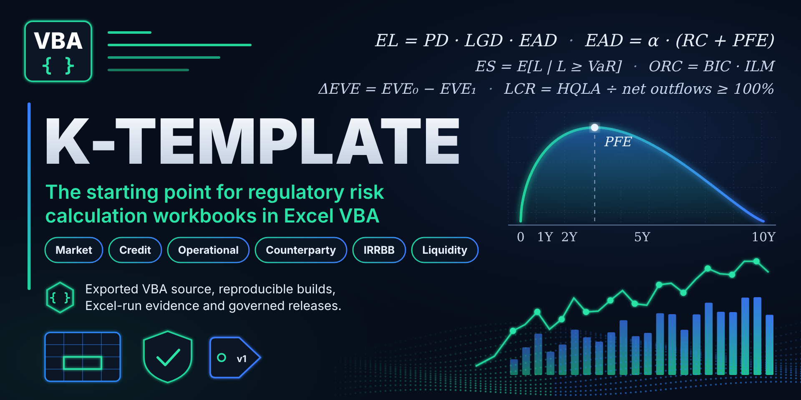
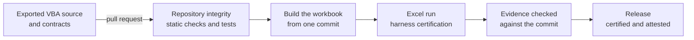

<div align="center">



# 🧰 K-TEMPLATE

### The starting point for regulatory risk calculation workbooks in Excel VBA

**SA-CCR · SFT · FRTB · LCR · NSFR · Exported VBA source · Reproducible builds · Excel-run evidence · Governed releases**

<br>

[](#-vba-development)
[](INSTALLATION.md)
[](#-quality-gates)
[](#-quality-gates)
[](#-license)
<br>[](docs/repo_governance/TRAFFIC.md#badges)
[](docs/repo_governance/TRAFFIC.md#badges)
[](docs/repo_governance/TRAFFIC.md#badges)

<br>

**Text-first and reviewable: exported VBA, JSON contracts and Markdown evidence, every change through a pull request**

[What it is](#-what-this-template-is)
&nbsp;·&nbsp;
[What you get](#-what-you-get)
&nbsp;·&nbsp;<!-- template-only:start -->
[Quick start](#-start-a-new-repository)<!-- template-only:replacement
[Find your way](#-find-your-way)--><!-- template-only:end -->
&nbsp;·&nbsp;
[Lifecycle](#-from-source-to-release)
&nbsp;·&nbsp;
[Quality gates](#-quality-gates)
&nbsp;·&nbsp;
[Documentation](#-documentation)
&nbsp;·&nbsp;
[Status](#-status)<!-- template-only:start -->
&nbsp;·&nbsp;
[Template wiki](https://github.com/danielep71/K-TEMPLATE/wiki)<!-- template-only:end -->

---

</div>

## ✨ What this template is

I use this template to start repositories for regulatory risk calculation
workbooks, such as SA-CCR, SFT, FRTB, LCR and NSFR. A workbook built from it
is not stored as a macro-enabled file: it is built from exported VBA source and
an optional macro-free template, so every line of calculation code is
reviewable in a pull request, and every Excel run leaves evidence that a check
binds to one commit.

The template holds no calculation of its own. It provides the repository around
one: the source layout and house style, the methodology guides to fill in, the
test harness and its evidence, the release process, and the GitHub governance
that keeps them honest.

## 🎯 What you get

| Area | What the template provides |
| --- | --- |
| Source control for Excel | Editing and Git policies for workbooks, exported VBA source and byte-preserved regulatory source copies |
| VBA quality | Static checks of exported VBA (layout, names, `#If` structure, jump targets, visibility, dependency direction, identifiers, `Err` copies, native declarations, calls) and a layout formatter, run on every change |
| Reproducible builds | A macro-enabled workbook built from the source of one commit, without *Trust access to the VBA project object model*, with the export bound to the workbook it came from |
| Testing and evidence | A VBA test harness with a certification entry point, numerical test cases and accuracy contracts, and an offline check that the evidence of an Excel run matches one commit |
| Methodology | Guides for the sources, the data contract, the calculation and workbook contracts and the validation plan, with a traceability table from each rule to its tests |
| Python quality gates | Ruff, strict mypy and actionlint, plus tests that hold the workflows to pinned actions, explicit permissions and the required check |
| Links | Relative links, anchors and HTTPS on every change; external links weekly |
| Issues and pull requests | Issue labels, issue forms, triage automation, a pull request template with a final-head review, and a workflow that keeps milestones on issues only |
| GitHub settings | A documented settings baseline (general settings, security features, rulesets, Actions settings) that a script previews, applies and verifies, writing a dated evidence record |
| Security | A security policy, a review to record before distribution, CodeQL scanning of the Python, JavaScript and workflow code, an OpenSSF Scorecard measure, and Dependabot updates for the pinned Actions and the hash-locked Python dependencies |
| Releases | A release process with a changelog, a certification record, a milestone closeout and a reproducible, attested source bundle |
| Traffic | Optional daily collection of clones and visitors, with the badges above |

<!-- template-only:start -->
## 🚀 Start a new repository

GitHub copies files from a template, not its settings. In order:

1. Create the repository with **Use this template**. GitHub copies the
   default branch of this template as it is at that moment, not a release tag:
   record the template commit the new repository came from, or the release
   tag when the default branch equals it, so that later template changes
   can be compared with it.
2. Adapt the files to the new repository, in a clean clone of it. The first
   command lists the changes and writes nothing; `--apply` makes them, then
   deletes the initializer and its test, its last change. Neither changes
   anything on GitHub. `PREFIX` is the project's short name, such as `LCR`:

   ```sh
   python tools/initialize_repository.py --repository OWNER/NEW-REPO --regime PREFIX
   python tools/initialize_repository.py --repository OWNER/NEW-REPO --regime PREFIX --apply
   ```

   Add `--release-branch BRANCH` to point Dependabot at an existing release
   branch, `--assignee LOGIN` to assign the issue forms and Dependabot's pull
   requests to another GitHub account, and `--remove-traffic` to remove the
   optional traffic collection, or `--remove-traffic-badges` to remove only
   its badges. Review the diff and commit it.

   The setup guide's
   [*Template cleanup*](docs/setup/REPOSITORY_SETUP.md#-before-you-start)
   lists what the initializer changes, and what **Repository integrity**
   checks until it is done. Without the initializer, make the same edits by
   hand.

3. Enable Actions and let **Repository integrity** pass on the default branch.
4. Apply and verify the settings baseline, as the
   [repository setup guide](docs/setup/REPOSITORY_SETUP.md) describes. It
   needs Python 3.11+ and GitHub CLI authentication; applying needs
   administrator access, the `PLAN SHA-256` that the preview prints and a new
   journal path. Set the Actions settings it reports, which it never
   writes, in **Settings → Actions → General**. Run it on a task branch, and
   merge the journal, report and evidence it writes through a pull request:
   applying protects the default branch.

   ```sh
   git switch -c docs/settings-evidence
   python tools/setup_repository.py --repo OWNER/NEW-REPO
   python tools/setup_repository.py --repo OWNER/NEW-REPO --apply --approve-plan PLAN_SHA256 --journal docs/repo_governance/settings-journal-YYYY-MM-DD.json
   python tools/setup_repository.py --repo OWNER/NEW-REPO --check --report docs/repo_governance/SETTINGS_EVIDENCE.md --evidence 'docs/repo_governance/settings-evidence-{date}.json'
   ```

5. Run **Sync issue labels** and create milestones with due dates
   ([issue labels](docs/repo_governance/ISSUE_LABELS.md)).
6. Adapt, replace or remove the remaining template files, as the setup
   guide's [handover table](docs/setup/REPOSITORY_SETUP.md#recommended-handover)
   says. The initializer leaves them as they are: among them the title,
   introduction and banner of this README, the social preview in
   `docs/assets/`, the repository's **About** fields, and the illustrative
   methodology, cases and contracts. It replaces this section and the
   template's wiki links with a table of the main guides.
7. Unless you removed it, optionally enable traffic collection
   ([traffic history](docs/repo_governance/TRAFFIC.md)).
8. If Codex reviews your pull requests, check that it reviews the new
   repository's first one; no Codex environment is needed
   ([pull request review](docs/repo_governance/PULL_REQUESTS.md)).

The [settings reference](docs/repo_governance/SETTINGS.md) and its
[JSON configuration](docs/setup/repository-settings.json) describe the baseline.
<!-- template-only:replacement
## 📍 Find your way

| I want to… | Read |
| --- | --- |
| Move VBA source between the repository and Excel, or record an Excel run | [Installation](INSTALLATION.md) |
| Write VBA that passes the static checks | [VBA house style](docs/VBA_HOUSE_STYLE.md) |
| Know where a component belongs and what it may call | [Repository structure](docs/REPOSITORY_STRUCTURE.md) |
| Record the sources, the data and the calculation, and how they are tested | [Methodology](docs/methodology/README.md) |
| Propose a change and run the checks locally | [Contributing](CONTRIBUTING.md) |
| Label, triage or plan an issue | [Issue labels](docs/repo_governance/ISSUE_LABELS.md) |
| Check or reapply the GitHub settings | [Repository setup](docs/setup/REPOSITORY_SETUP.md) |
| Prepare, certify and publish a release | [Releasing](RELEASING.md) |
-->
<!-- template-only:end -->

## 🔄 From source to release

Each step leaves something a later step, or a reviewer, can check:



| Step | Tool or record | What it proves |
| --- | --- | --- |
| Change | Pull request, with the [final-head review](docs/repo_governance/PULL_REQUESTS.md) | The reviewed commit is the one merged |
| Check | `python tools/check_repository.py` | Every **Repository integrity** check passes locally as in CI |
| Build | `tools/devbuild/build_workbook.py` | The workbook comes from the source of one commit, byte for byte reproducible |
| Run | `tools/devbuild/excel_run.py` | The harness certification ran in Excel, with a host record |
| Evidence | `python tools/check_excel_run.py` | The run's logs and results match the commit and the evidence policy |
| Release | [RELEASING.md](RELEASING.md), `python tools/release.py` | The tag, the changelog, the certification and the published assets agree |

## ✅ Quality gates

| Workflow | What it checks |
| --- | --- |
| **Repository integrity** | The required check: Python, VBA, workflow, link, changelog, test-case and governance checks, with the unit tests |
| **Minimum Python** | The unit tests on the minimum supported Python |
| **CodeQL** | Code scanning of the Python, JavaScript and workflow code |
| **OpenSSF Scorecard** | The supply-chain posture of the default branch; a run on any other branch skips the analysis |
| **Link check** | External links |
| **Sync issue labels** · **Detect issue-label drift** | The live labels against `.github/labels.json`, never deleting one in use |
| **Detect settings drift** | The live rulesets and the other settings a read-only token can read against `docs/setup/repository-settings.json`; the rest is listed as not checked |
| **Issue triage** | Every open issue against the [triage rules](docs/repo_governance/ISSUE_LABELS.md#triage-rules) |
| **Closing keywords** | The closing keywords a pull request would carry to the default branch: none into a release branch, none for an open issue in an integration |
| **Keep milestones issue-only** | Removes any milestone set on a pull request, and lists each removal |
| **Release** | Verifies the tag, builds a reproducible source bundle, attests it where the repository allows it and drafts the release |
| **Traffic history** | Optional: collects clones and visitors for the badges above |

Each workflow runs on the events of its `on:` block:

<!-- BEGIN generated: workflow-triggers -->
| Workflow | When it runs |
| --- | --- |
| [**Closing keywords**](.github/workflows/closing-keywords.yml) | Pull requests (opened, synchronize, reopened, edited) |
| [**CodeQL**](.github/workflows/codeql.yml) | Pushes to `main`; pull requests into `main`, `release/**` unless they change only `**/*.md`, `docs/**`; weekly on Wednesday at 04:29 UTC; manual runs |
| [**Issue triage**](.github/workflows/issue-triage.yml) | Issue events (opened, edited, reopened, closed, labeled, unlabeled, assigned, unassigned, milestoned, demilestoned); milestone events (edited, closed, opened, deleted); manual runs |
| [**Detect issue-label drift**](.github/workflows/labels-drift.yml) | Weekly on Tuesday at 05:23 UTC; manual runs |
| [**Sync issue labels**](.github/workflows/labels-sync.yml) | Pushes that change `.github/labels.json`, `.github/scripts/labels-sync.mjs`, `.github/workflows/labels-sync.yml`; manual runs |
| [**Link check**](.github/workflows/link-check.yml) | Weekly on Monday at 06:43 UTC; manual runs |
| [**Minimum Python**](.github/workflows/minimum-python.yml) | Pull requests that change `**/*.py`, `tests/**`, `tools/**`, `.github/scripts/**`, `pyproject.toml`, `.github/requirements.txt`, `.github/workflows/minimum-python.yml`; pushes to `main`; manual runs |
| [**Keep milestones issue-only**](.github/workflows/pr-milestones.yml) | Pushes that change `.github/workflows/pr-milestones.yml`; pull requests (opened, reopened, edited, milestoned), run from the base branch; weekly on Friday at 03:37 UTC; manual runs |
| [**Release**](.github/workflows/release.yml) | Pushes of the tags `v*.*.*`; manual runs |
| [**Repository integrity**](.github/workflows/repository-integrity.yml) | Every pull request; pushes to `main`, `release/**`; manual runs |
| [**OpenSSF Scorecard**](.github/workflows/scorecard.yml) | Branch protection rule changes; every push; weekly on Thursday at 05:41 UTC; manual runs |
| [**Detect settings drift**](.github/workflows/settings-drift.yml) | Daily at 04:41 UTC; manual runs |
| [**Traffic history**](.github/workflows/traffic-history.yml) | Daily at 06:17 UTC; manual runs |
<!-- END generated: workflow-triggers -->

## 🧩 VBA development

- The [repository structure](docs/REPOSITORY_STRUCTURE.md) says where each VBA
  component lives and which may call which.
- The [house style](docs/VBA_HOUSE_STYLE.md) covers naming, contracts, errors
  and cleanup.
- The [public API inventory](docs/PUBLIC_API.txt) lists the supported entry
  points, and every other public declaration under `src/`.
- The [installation guide](INSTALLATION.md) moves source between the
  repository and Excel, and covers upgrades, troubleshooting and removal.

## 📦 Repository structure

```text
.github/   workflows, issue forms, labels, Dependabot and the Excel evidence policy
docs/      methodology, release records, governance, setup, house style, licenses
tests/     VBA harness and example suite, test cases, accuracy contracts, Python tests
tools/     static checks, workbook build and Excel run, release, setup and initializer
src/       the workbook's VBA source and macro-free template (reserved: added by a project)
```

The full layout and its rules are in
[`docs/REPOSITORY_STRUCTURE.md`](docs/REPOSITORY_STRUCTURE.md).

## 📚 Documentation

| Document | Covers |
| --- | --- |
| [`docs/methodology/`](docs/methodology/README.md) | Sources, data contract, calculation and workbook contracts, test cases, test harness, validation plan |
| [`INSTALLATION.md`](INSTALLATION.md) | Moving source between the repository and Excel, recording an Excel run, upgrades, troubleshooting and removal |
| [`docs/REPOSITORY_STRUCTURE.md`](docs/REPOSITORY_STRUCTURE.md) | Source layout, reserved paths, dependency direction |
| [`docs/VBA_HOUSE_STYLE.md`](docs/VBA_HOUSE_STYLE.md) | VBA naming, contracts, errors, cleanup and static checks |
| [`docs/repo_governance/`](docs/repo_governance/README.md) | Settings, issue labels, pull requests, traffic, distribution |
| [`docs/setup/REPOSITORY_SETUP.md`](docs/setup/REPOSITORY_SETUP.md) | Setting up a new repository and what to keep, adapt or remove |
| [`RELEASING.md`](RELEASING.md) | How a version is prepared, certified and published, and the current status |
| [`docs/release/`](docs/release/CLOSEOUT.md) | The milestone [closeout](docs/release/CLOSEOUT.md) and the [release certification](docs/release/RELEASE_CERTIFICATION.md) records, and the [maintenance audit](docs/release/MAINTENANCE_AUDIT.md) done before each release |
| [`CONTRIBUTING.md`](CONTRIBUTING.md) | Workflow, checks, rules of evidence and pull requests |
| [`SECURITY.md`](SECURITY.md) | Private vulnerability reporting, runtime risk surface and data handling |
| [`CODE_OF_CONDUCT.md`](CODE_OF_CONDUCT.md) | Participant behaviour and conduct reporting |
| [`CHANGELOG.md`](CHANGELOG.md) | Change history<!-- template-only:start --> |
| [Template wiki](https://github.com/danielep71/K-TEMPLATE/wiki) | A guided tour of the template, page by page; the documents above govern where it differs<!-- template-only:end --> |

## 📌 Status

The release state is recorded in one place: the
[*Current status*](RELEASING.md#current-status) of `RELEASING.md`, which
**Repository integrity** checks against [`CHANGELOG.md`](CHANGELOG.md).
Development continues on the active release branch through task branches and
pull requests; only a release is versioned and tagged.

## 🔐 Data and security

No real portfolio data: never commit or attach real trades, positions,
counterparty data, or any client or employer material. VBA runs with the
user's Office permissions: review the source and follow your organisation's
macro policy. Report suspected vulnerabilities privately as described in
[`SECURITY.md`](SECURITY.md).

## 🧭 Contributing

To take part, read the [contributing guide](CONTRIBUTING.md) and the
[code of conduct](CODE_OF_CONDUCT.md).

## 👤 Author

**Daniele Penza** — [@danielep71](https://github.com/danielep71)

## 📄 License

Repositories created from this template default to the [Mozilla Public License 2.0](LICENSE).
If you choose a different license for a new repository, replace `LICENSE` and keep
[`docs/licenses/`](docs/licenses/THIRD_PARTY_NOTICES.txt): the files listed there keep
the license the notice states for them, MPL-2.0 or MIT.
